# Safarnama

[](https://github.com/RANAV2004/Itinerary-Bot/actions/workflows/ci.yml)

*Safarnama* (Hindi/Urdu: the story of a journey) is a multi-agent trip planner for Indian travel. You give an origin, a destination, dates, a budget and the number of travellers. Specialised agents find transport, a stay and places to visit in parallel, a coordinator moves money between them when the plan goes over budget, and a critic checks the final itinerary for things that would break in real life.

The project is built to answer one question honestly: does splitting the work across agents produce better plans than a simpler approach? An evaluation suite compares the two on 50 fixed test trips.

## What you can do

1. **Create an account** with your name, date of birth, email and a password, then sign in with your email and password. Forgot it? Safarnama emails you a 6 digit code to choose a new one. Every account gets a unique 5 digit user ID.
2. **Pick what you love.** On your first sign in, choose from 14 interests such as beaches, mountains and hills, trekking, scenic views and sunsets, history, nature, shopping and food. Every itinerary puts places that match them first, and the Interests button changes them any time.
3. **Enter your trip** on the dashboard: from, to, dates, budget, travellers, interests and an optional note.
4. **Generate the itinerary.** The form is pulled into a pink outline globe, which zooms to your starting city, flies a dotted line to your destination, then spins away as the itinerary opens. The agents' live steps show underneath.
5. **Change anything.** Swap the train or hotel for another option, remove a place, add a place, or edit any trip detail.
6. **Regenerate.** The agents keep your choices fixed and re-plan everything else around them, including the budget.
7. **Or just say what you want.** Type "remove the flea market, add another beach and get me a cheaper hotel" in the chat under the plan. Safarnama replans and lists exactly what changed. Ask "what is the history of Fort Aguada?" and it answers from its travel guide, showing which entry it used.
8. **It learns what you like.** Every change you ask for is remembered for your account. Remove shopping twice and later trips leave markets out, with a note saying why. One click on Forget wipes it.
9. **Teach it.** The chat runs on Safarnama's own model, with no API key. Each reply asks "Did I get that right?". Yes saves your words as training examples. Not right lets you pick what you meant, then the model retrains on the spot and tries again.
10. **Download it as a PDF.**
11. **Everything is saved.** "Hi, Vansh" in the top bar opens a menu with Settings, My itineraries, Interests, Help center and Sign out. Settings shows your profile and user ID, every itinerary you have made (open one to keep editing it, or delete it), a change password form and the help center.
12. **See every place properly.** Each place in the plan has a photo, a short description and tips. Tap it for a details sheet with a map of where it is, plus Open in Google Maps and Directions buttons. Each day also suggests a restaurant and a cafe near that day's sights.
13. **Stops on the way.** The plan lists real towns and places worth a break between your start and destination, in travel order along the actual road, each marked as on the way or a detour of so many km, with a place to eat there.
14. **Already booked?** Pick Flight, Train or Bus and paste your ticket: an airline email, an IRCTC e-ticket or a redBus ticket. Safarnama reads the airline or train name and number or the bus operator, the cities or station codes, the date, the departure and arrival times and the fare, lets you check and edit them, and builds day 1 around your arrival.
15. **Travel with friends.** Invite friends with a link, sent through Gmail, another email app or copied. When they open it and join, the itinerary appears in their account too, and everyone on the trip can view, chat with and regenerate it. The planner can remove people and anyone can leave.
16. **Explore 41 destinations.** Search or filter by Beaches, Mountains, Trekking, Heritage, Spiritual, Nature, Big cities or Nepal. Each destination has Restaurants, Attractions, Cafes and Photo spots, its Top places, and Travel information with Intro, Understand, Get in, Get around and Stay safe. The data is real: it comes from Wikivoyage, or live from Google Maps when a Google key is set.
17. **Install it as an app.** On a phone, open the site and choose Install app (Android) or Add to Home Screen (iPhone). Safarnama then opens full screen from its own icon, like a native app.
18. **Admin panel.** Admins search users by user ID, name or email, ban or unban them, delete accounts with all their data, and open any user to see their itineraries. A second tab lists every itinerary as "Indore to Goa itinerary" with its amount, budget and the user ID that created it.

<p>
  
  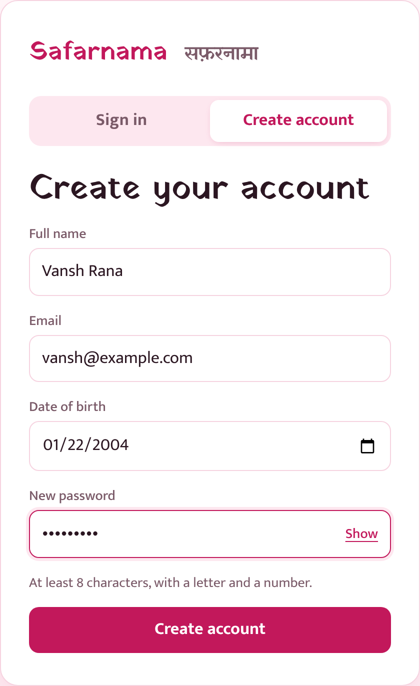
</p>
<p>
  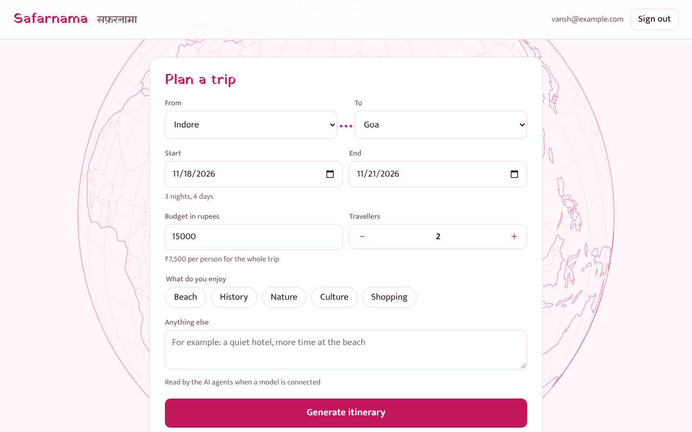
  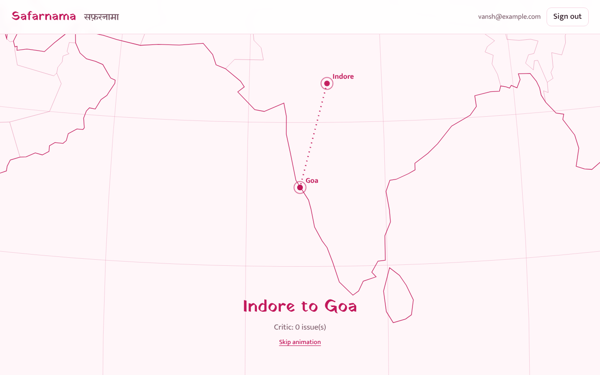
</p>
<p>
  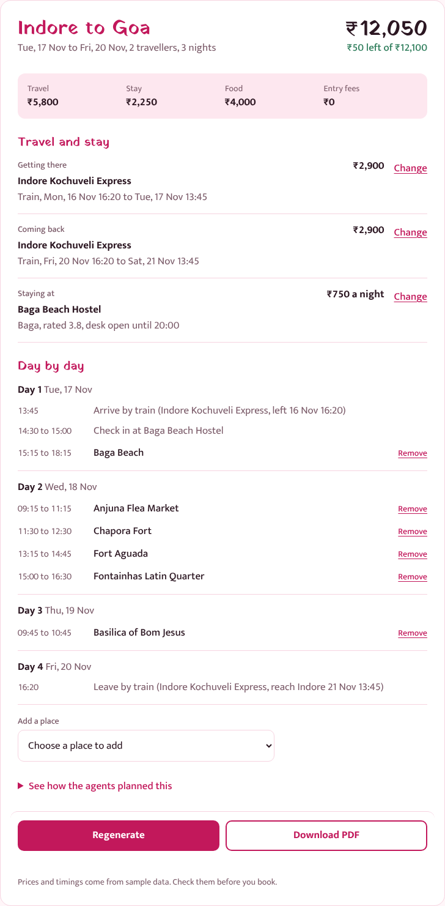
  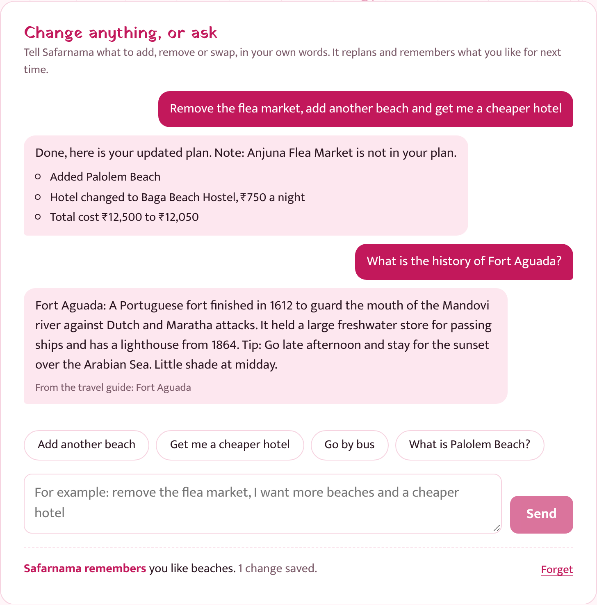
</p>
<p>
  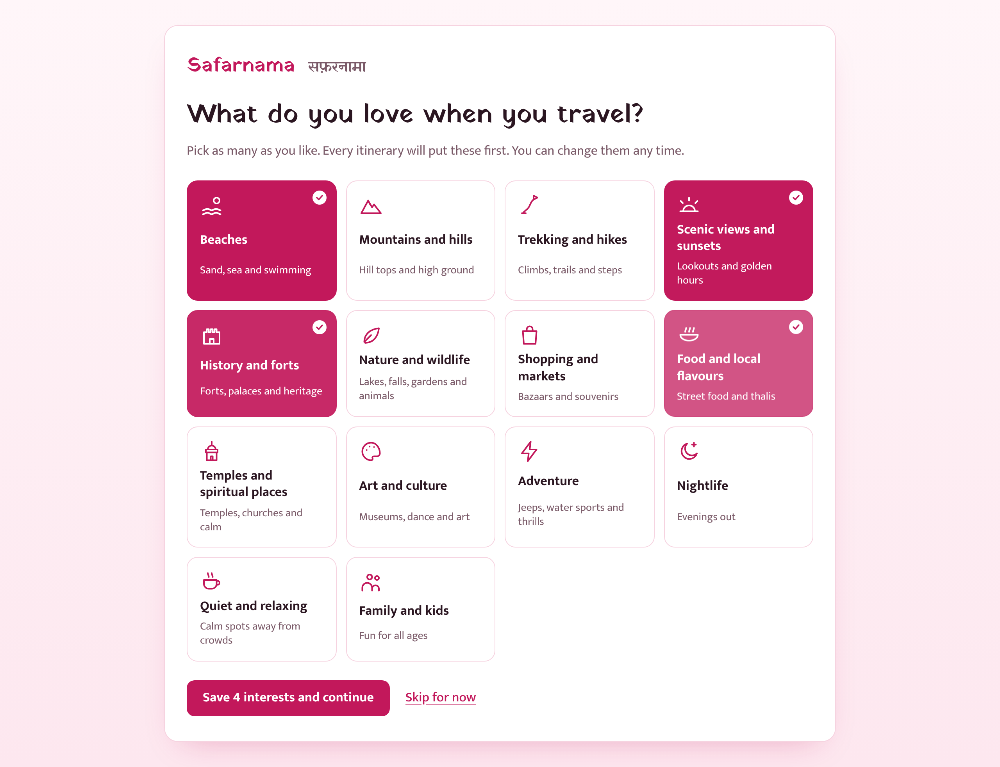
  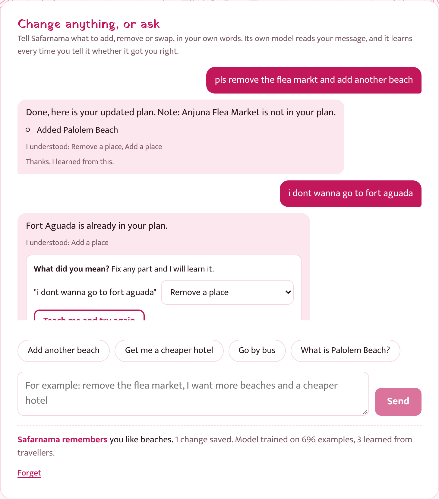
</p>
<p>
  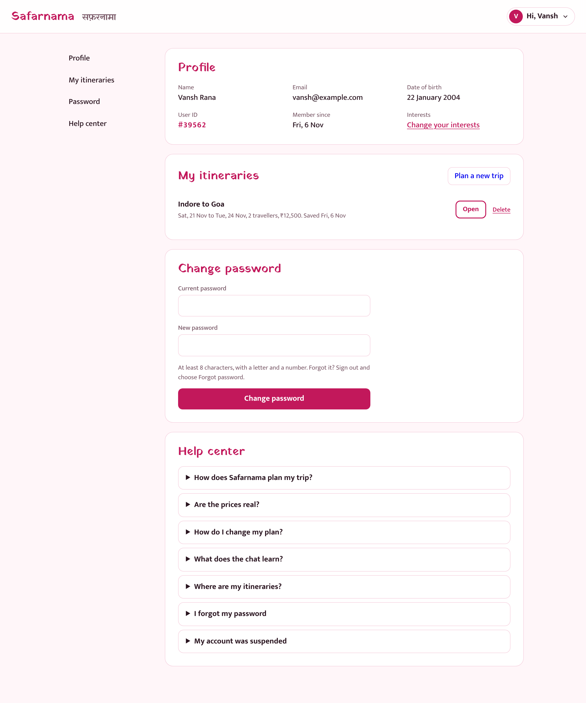
  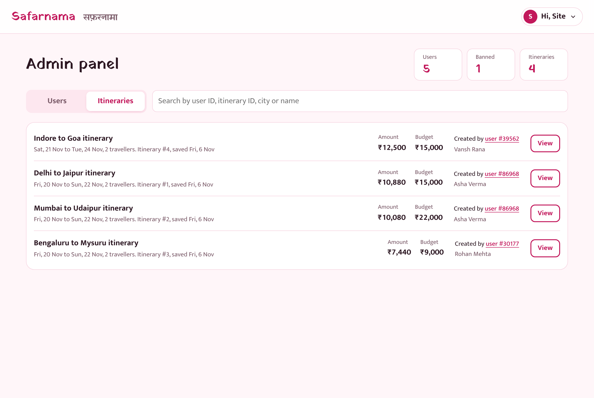
</p>
<p>
  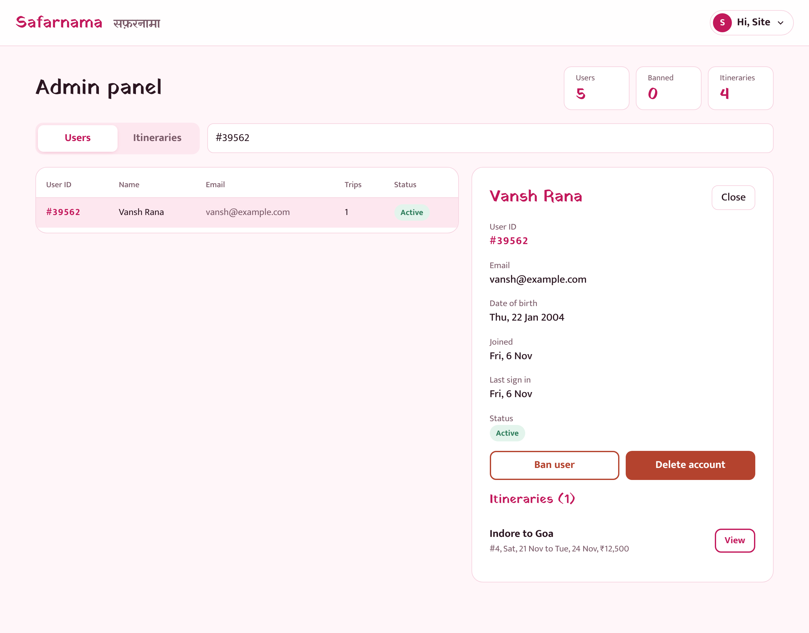
  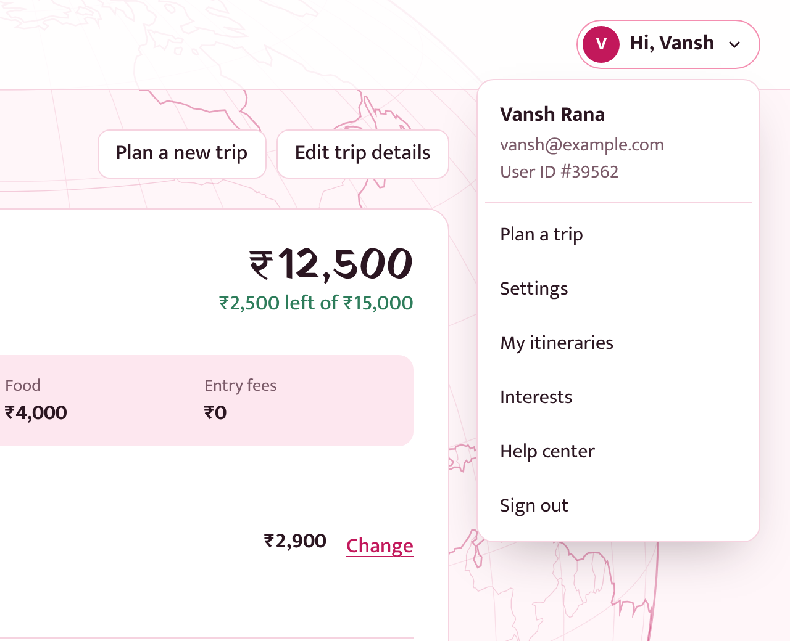
</p>

## How it works

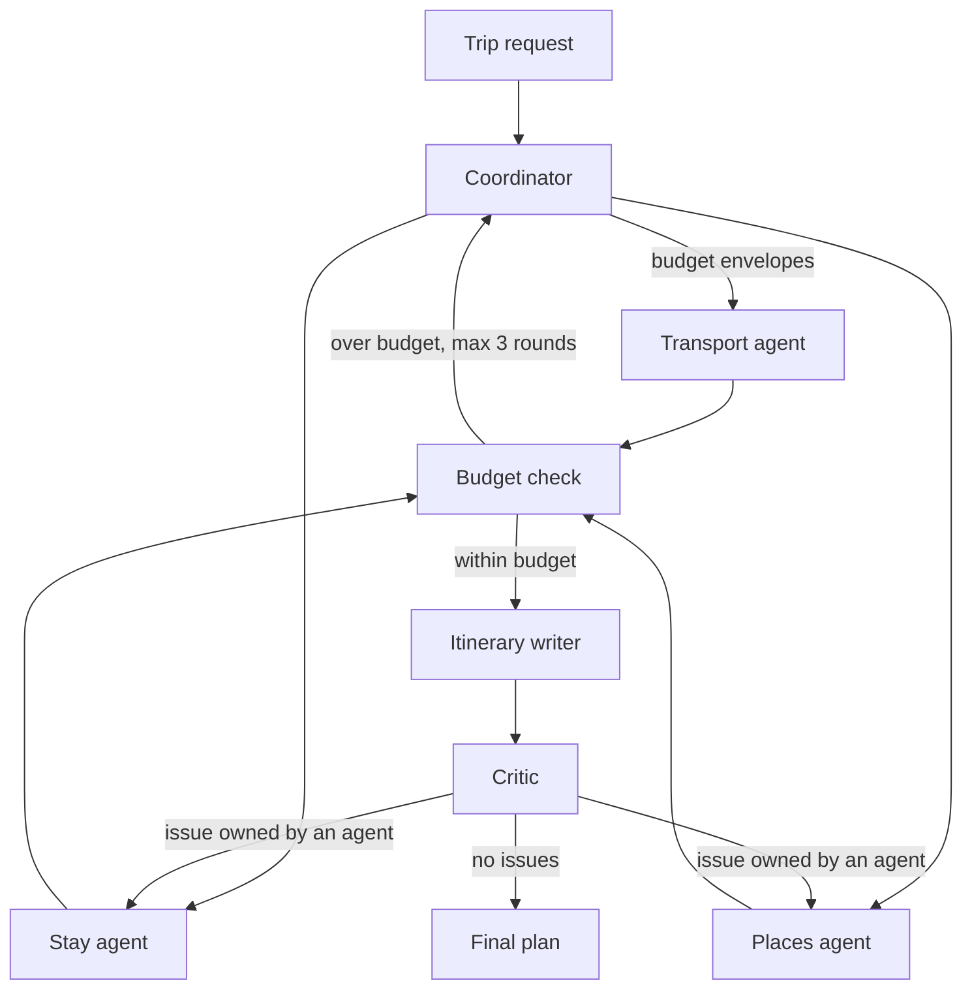

| Agent | Job | Uses an LLM for |
|---|---|---|
| Coordinator | Splits the budget into envelopes. If the plan is over budget, cuts the envelopes of agents that can still go cheaper and reruns only them | Proposing a reallocation, which code validates |
| Transport | Finds outbound and return options, keeps only valid pairs, ranks them by price and daytime lost on the road | Choosing from a shortlist |
| Stay | Finds hotels within the per night cap, respects check-in desk timings when told the traveller arrives late | Choosing from a shortlist |
| Places | Picks attractions open on the trip days that fit the activities budget and available hours | Choosing a set of places |
| Budget check | Adds up the real cost | Never, plain Python |
| Writer | Builds a day by day schedule around arrival, departure, opening hours and distance | A short summary |
| Critic | Runs hard checks and sends each problem back to the agent responsible for it | Optional soft tips only |

### Chat, RAG and its own model

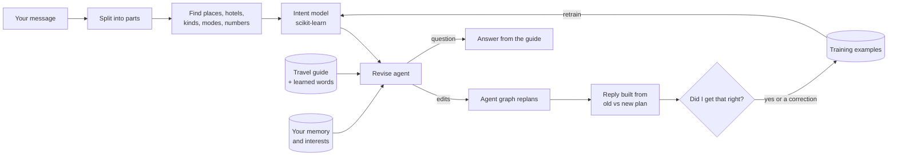

- **No API key.** The chat never calls an outside model. Everything runs in the backend with scikit-learn.
- **Entities first.** Each part of a message is scanned for place and hotel names (with typo tolerance, so "pallolem" finds Palolem Beach), kinds of place ("beaches", "museums"), travel modes and numbers, which are swapped for tokens like `_place_`. "I dont wanna go to Fort Aguada" becomes `i dont wanna go to _place_`, so what the model learns in Goa also works in Jaipur.
- **Intent model.** A TF-IDF (words and character n-grams) plus logistic regression classifier picks one of 12 intents: add or remove a place, a cheaper, better or named hotel, change travel, budget, travellers, like, dislike, question, or something else. It starts from about 700 seed sentences and is saved to `data/intent_model.joblib`.
- **It learns, and keeps what it learns.** Every sentence it understands with 85 percent confidence or more is saved as an example. Yes on a reply saves its sentences with double weight, and a correction saves them with triple weight and deletes any wrong automatic copies. All examples live in SQLite, and the model retrains from them, straight away after feedback and after every 10 automatic examples. Sentences it is less than 45 percent sure about are treated as "something else", and you get help instead of a guess.
- **Retrieval that learns too.** Questions and vague requests ("somewhere for sunset") are matched against the travel guide with TF-IDF vectors and cosine similarity. When you say Yes to a place it found from a vague request, your words are attached to that place, so "somewhere romantic" finds it next time.
- **Grounded replies.** Edits go back through the full agent graph, and the reply is built by comparing the old and new plans, so it never claims a change that did not happen. Requests that cannot be done are explained.
- **Memory and interests.** Interests from the first sign in, plus likes and avoids learned from changes, shape every new plan: matching places rank higher, avoided kinds are left out with a note, and the places agent says which interests it planned around.

### Examples of the agents working together

- A tight budget for Indore to Goa: the transport agent cannot fit its 35 percent envelope, so the coordinator takes the difference from the stay agent, which reruns and picks a cheaper hostel.
- A late evening arrival: the critic sees that the hotel desk closes before the traveller reaches it and asks the stay agent for a hotel with late check-in.
- Places spread across a state: the critic flags a day with too much local travel and the places agent reruns, keeping only spots near the hotel.

## Design decisions

- **Money is always integer rupees.** No floats anywhere in budget code, and the envelopes always add up to the exact budget.
- **The LLM never does arithmetic.** Totals, budget splits, distances and timing checks are deterministic Python. The model only chooses between options that code has already filtered.
- **Model output is validated, never trusted.** Every LLM call returns a Pydantic schema. Unknown ids are rejected, a choice that breaks the budget is rejected, and on any failure the agent falls back to a rule based pick.
- **Data sources sit behind interfaces.** Each provider has a fixture implementation and a live one. Live calls are wrapped so that a timeout or a shut down API falls back to fixtures and records the error. Amadeus closed its self-service API in July 2026; with this design, replacing a data source means adding one provider file.
- **Hard limits on loops.** Negotiation stops after 3 rounds and the critic after 2. If a budget is genuinely impossible, the plan says how much it is over instead of looping forever.
- **The user's choices win.** A hotel, journey or place the user picks is pinned. The agents plan around it, and the coordinator will not cut below it. If a pinned choice causes a problem, such as a late arrival, the plan says so instead of quietly swapping it out.
- **Accounts kept safe.** Passwords are stored only as salted PBKDF2 SHA-256 hashes with 200,000 rounds and compared in constant time. 5 wrong tries from one address lock sign in for that email from that address for 15 minutes, and each address gets 30 sign in, sign up and reset requests per 15 minutes, so a stranger cannot lock you out. Unknown emails get the same answer as wrong passwords. Password resets use a 6 digit code sent by email that expires after 15 minutes and 5 wrong tries. Sessions are signed JWTs in an httpOnly, SameSite cookie that page scripts cannot read, and requests that change data must also send an `X-Requested-With` header. Each token carries a version number, so changing a password, resetting it or being banned signs out every device at once.
- **Input is checked at the edge.** Request bodies over 1 MB are refused, lists and text fields have maximum sizes, trips cannot start in the past, and cities without data are refused with a clear message. Text placed into the PDF is escaped, so it cannot load files from the server.
- **The chat model is protected.** Each reply can be rated once, each account can add at most 100 training examples a day, and retraining runs after the response instead of inside it.
- **Every step is traced.** Each agent records its duration, tokens, cost and a short note, so a run can be inspected step by step.

## Evaluation

`evals/run_evals.py` runs 50 fixed trips across 8 routes at five budget levels, from very tight to generous, and scores every system with the same hard checks.

Current results with the LLM switched off (rule based agents, fixture data):

| Metric | Multi-agent | Single pass, no negotiation or critic |
|---|---|---|
| Complete plans | 100% | 100% |
| Within budget | 96% | 96% |
| Plans with zero violations | **100%** | 58% |
| Avg violations per plan | **0.00** | 0.48 |
| Avg latency | 7 ms | 1 ms |

The critic loop is what removes the violations: 20 days with too much local travel and 4 late arrivals at a closed hotel desk in the single pass version. The two trips that miss the budget are infeasible at every level; even the cheapest options exceed the budget, and the planner reports the shortfall.

With an API key set, the suite also runs a third system, a single LLM call that sees every option and writes the whole plan, and reports tokens and cost per plan. Full output is written to `evals/results.md`.

## Quick start

Requires Python 3.11 or newer and Node.js 20 or newer. Runs without any API keys.

**Backend**

```bash
git clone https://github.com/RANAV2004/Itinerary-Bot.git
cd Itinerary-Bot
python -m venv .venv
source .venv/bin/activate        # Windows: .venv\Scripts\activate
pip install -r requirements.txt
cp .env.example .env             # sets SAFARNAMA_ENV=dev for local use

pytest                           # 218 tests with coverage report
python -m evals.run_evals        # writes evals/results.md
uvicorn app.api:app --reload --env-file .env   # API on http://localhost:8000
```

**Frontend**, in a second terminal:

```bash
cd frontend
npm install
npm run dev                      # open http://localhost:3000
```

The frontend calls the backend at `http://localhost:8000`. To change that, copy `frontend/.env.example` to `frontend/.env.local` and set `NEXT_PUBLIC_API_URL`.

**Becoming an admin.** Put your email in `ADMIN_EMAILS` in `.env` before you sign up, or make an existing account an admin with `python -m scripts.make_admin you@example.com`. Admins see Admin panel in the menu under their name.

## Testing

218 tests cover 99 percent of the backend, and CI fails if coverage drops below 85 percent.

- **LLM path:** tested with a fake model, so tests prove that unknown ids, out of range choices and plans that break the budget are rejected, with no API key needed.
- **Sign in:** expiry, single use, lockout after wrong codes, resend limit, hashed storage, bad and expired tokens, and email sending with a fake mail server.
- **User edits:** pinned journeys and hotels survive the budget loop and the critic, removed places stay out, added places stay in, and invalid choices fall back with a message.
- **Live providers:** fake HTTP responses, including timeouts and quota errors.
- **PDF:** generated for normal trips, day trips and over budget plans.

## Configuration

| Variable | Default | Purpose |
|---|---|---|
| `ANTHROPIC_API_KEY` | not set | Enables LLM choices in the agents. Without it every agent runs rule based |
| `LLM_MODEL` | `claude-haiku-5-5` | Model used by all agents |
| `LLM_MODE` | `auto` | Set to `off` to force rule based mode even with a key |
| `LLM_INPUT_USD_PER_M`, `LLM_OUTPUT_USD_PER_M` | `1.0`, `5.0` | Prices used for cost tracking, set them to your model's rates |
| `PROVIDER_MODE` | `fixture` | `live` uses SerpApi for flights and hotels with fixture fallback |
| `SERPAPI_KEY` | not set | Needed for live mode |
| `CORS_ORIGINS` | `http://localhost:3000,http://127.0.0.1:3000` | Frontend addresses allowed to call the API |
| `SECRET_KEY` | required | Signs sessions and reset codes. Use a random string of at least 32 characters. The API refuses to start without it, unless `SAFARNAMA_ENV` is `dev` |
| `SAFARNAMA_ENV` | not set | `dev` for local use: allows a random `SECRET_KEY` and cookies over plain http |
| `COOKIE_SECURE` | `1`, or `0` in dev | Sends the session cookie only over https |
| `TRUST_PROXY` | not set | `1` when the API sits behind a proxy, so rate limits use the real visitor address from `X-Forwarded-For` |
| `SMTP_HOST`, `SMTP_PORT`, `SMTP_USER`, `SMTP_PASSWORD`, `SMTP_FROM` | not set | Mail server for reset codes. Without `SMTP_HOST` the code is written to the API log, which is fine for local use only |
| `ADMIN_EMAILS` | not set | Comma separated emails that become admins when they sign up or sign in |
| `PASSWORD_ROUNDS` | `200000` | PBKDF2 rounds for new password hashes. Tests lower it to stay fast |
| `SAFARNAMA_DB` | `data/safarnama.db` | SQLite file for profiles, memory, training examples and learned words |
| `SAFARNAMA_MODEL` | next to the database | Where the trained intent model is saved |
| `GOOGLE_MAPS_API_KEY` | not set | A Google Maps Platform key with Places API (New) turned on. When set, Explore, stops on the way and meal suggestions come live from Google Maps, ranked by rating, with Google photos. Results are kept in memory for an hour only, as Google's terms require |
| `PLACES_MODE` | `auto` | `off` ignores the Google key and uses the Wikivoyage data |
| `WIKI_MODE` | `live` | Fetches place photos and short summaries from Wikipedia and caches them for 30 days. `off` shows drawn artwork instead, which tests and CI use |

## API

| Method | Path | Sign in | Description |
|---|---|---|---|
| GET | `/health` | no | Status and whether the LLM is enabled |
| GET | `/routes` | no | Routes covered by the sample data |
| POST | `/auth/signup` | no | `{"name", "email", "birth_date", "password"}`. Creates an account with a unique 5 digit ID and signs in |
| POST | `/auth/login` | no | `{"email", "password"}`. Sets the session cookie and returns the user and a token for API clients |
| POST | `/auth/logout` | no | Clears the session cookie |
| POST | `/auth/forgot/start` | no | `{"email"}`. Emails a 6 digit reset code if the account exists. Always answers the same way |
| POST | `/auth/forgot` | no | `{"email", "code", "new_password"}`. Resets the password and signs in |
| POST | `/auth/change-password` | yes | `{"current_password", "new_password"}`. Signs out other devices |
| GET | `/auth/me` | yes | The signed in user: ID, name, email, date of birth, role |
| POST | `/plan` | yes | Full plan, with alternative journeys, hotels and places the user can swap in. Saved to the user's itineraries; pass `?trip_id=` to update an existing one |
| POST | `/plan/stream` | yes | Server sent events, one per agent step, then the final plan |
| POST | `/plan/pdf` | yes | Turns a plan into a PDF download |
| POST | `/plan/text` | yes | Plan from free text such as "3 days in Goa from Indore, 15k, 2 people" (needs an LLM key) |
| POST | `/plan/revise` | yes | `{"plan": <a plan>, "message": "..."}`. Returns the reply, the list of changes, guide sources, the new plan (or null for a question), what each part was understood as, and a `turn_id` for feedback |
| POST | `/learn` | yes | `{"turn_id": 12, "good": false, "fixes": {"0": "remove_place"}}`. Feedback on a chat reply, once per reply. Saves the examples and retrains the model after responding |
| GET | `/model` | yes | How many seed and learned examples the model has, by source, and its intents |
| GET | `/explore` | no | Destinations with counts of sights, restaurants, cafes and photo spots |
| GET | `/explore/{city}` | no | One city: the four categories, top places and travel information |
| GET | `/stops?origin=&destination=` | no | Stops on the way, in travel order, with distance from the start |
| GET | `/media/{id}` | no | Photo and summary for a place, from Wikipedia, cached |
| POST | `/bookings/parse` | yes | `{"text"}`. Reads pasted flight, train or bus details |
| POST | `/trips/{id}/invite` | yes | Makes an invite link that works for 7 days |
| DELETE | `/trips/{id}/invite` | yes | The planner turns off all invite links |
| GET | `/invites/{token}` | yes | Who invited you and to which trip |
| POST | `/invites/{token}/accept` | yes | Join the trip |
| DELETE | `/trips/{id}/members/{user_id}` | yes | Leave a trip, or the planner removes someone |
| GET | `/profile` | yes | Your interests, whether you finished the first sign in page, and all 14 options |
| PUT | `/profile` | yes | `{"interests": ["beaches", "views"]}`. Saves your interests |
| GET | `/trips` | yes | Your saved itineraries, newest first |
| GET | `/trips/{id}` | yes | One itinerary with its full plan (yours, or any for an admin) |
| DELETE | `/trips/{id}` | yes | Deletes one of your itineraries |
| GET | `/admin/stats` | admin | Users, banned users and itineraries |
| GET | `/admin/users?q=` | admin | Users matching a user ID (with or without #), name or email, with their itinerary count |
| GET | `/admin/users/{id}` | admin | One user and their itineraries |
| POST | `/admin/users/{id}/ban` | admin | `{"banned": true}` bans and signs them out, `false` unbans |
| DELETE | `/admin/users/{id}` | admin | Deletes the account and all its itineraries, interests and memory |
| GET | `/admin/trips?q=` | admin | Every itinerary with route, amount, budget and creator, searchable by user ID, itinerary ID, city or name |
| GET | `/memory` | yes | What Safarnama remembers about you: likes, avoids and past feedback |
| DELETE | `/memory` | yes | Forget everything |

Signed in endpoints take `Authorization: Bearer <token>`. In the docs page at `/docs`, sign in through the two auth endpoints, then press Authorize and paste the token.

Example request:

```json
{
  "origin": "Delhi",
  "destination": "Jaipur",
  "start_date": "2026-11-27",
  "end_date": "2026-11-29",
  "budget_inr": 15000,
  "travellers": 2,
  "preferences": ["history"],
  "stay_id": "jai-h2",
  "exclude_places": ["jai-p7"],
  "include_places": ["jai-p1"],
  "note": "prefer quieter places"
}
```

The last four fields are optional. They are how a regenerated plan keeps the user's choices.

## Project structure

```
app/
  state.py            shared state every agent reads and writes
  graph.py            LangGraph wiring, loops and routing
  llm.py              model calls with schema validation and retry
  auth.py             accounts, password hashing, sessions, admin check
  trips.py            saved itineraries
  admin.py            user search, ban, delete, all itineraries
  pdf.py              itinerary PDF
  api.py              FastAPI endpoints
  agents/             coordinator, transport, stay, places, writer, critic, intake, reviser
  rag/                vector index, travel guide retrieval, traveller memory
  ml/                 entity tagging, seed sentences, intent model
  profile.py          travel interests
  db.py               SQLite tables
  providers/          interfaces, fixture data, SerpApi, fallback wrapper
  tools/              budget maths, distance, hard checks
fixtures/             sample transport, hotel and place data for 8 routes, and the travel guide
evals/                test trips, baselines, runner and results
tests/                unit, agent, API and end to end tests
frontend/             Next.js app: splash, sign in and sign up, interests, dashboard, chat, settings, admin panel
docs/CODE_GUIDE.md    file by file explanation of the code
```

For a detailed walkthrough of every file and agent, see [docs/CODE_GUIDE.md](docs/CODE_GUIDE.md).

## Limitations

- Without a Google key, Explore uses Wikivoyage. Its guides list fewer cafes for some hill towns, and about a third of places have no exact map position, so their buttons search Google Maps by name. Wikivoyage photos exist for about one place in five; the rest show drawn artwork.
- Trip planning (transport, hotels and prices) still covers the eight sample routes. Explore covers 41 destinations.
- To refresh the data run `python -m scripts.build_explore` and then `python -m scripts.build_stops`. They fetch slowly on purpose, following Wikimedia's rules for automated access.

- Fixture data is realistic but hand made. Prices and timings are samples, not live quotes, and should be verified before travel.
- Live mode covers flights and hotels only. Trains and buses use sample data, since IRCTC and bus operators do not offer open APIs.
- The planner suggests and links, it does not book.
- Rate limits are kept in memory, so they reset on restart and are counted per server. A deployment with several servers should keep them in Redis.
- Data is kept in one SQLite file. That suits one server. A larger deployment would move to PostgreSQL, and free hosts that wipe the disk on restart need a persistent volume.
- The chat model is small and starts from about 700 seed sentences, so it is not as flexible as a large language model. It gets better as people use the Yes and Not right buttons.
- Retrieval uses TF-IDF vectors, which match words, not meaning, until learned words are attached to places. Swapping in neural embeddings means replacing one class.
- One message part has one intent, so "remove the fort and the beach" works, but very long run on sentences may need splitting.
- The sample data has no true mountain destinations yet, so "Mountains and hills" matches hill forts and hilltop temples.

## Roadmap

- Local sentence embeddings for the guide and memory
- Show learned training examples in an admin page for review
- Upgrade pass that spends unused budget on a better hotel or transport
- Visa and document checks for international trips
- Langfuse export for the trace data

## Tech stack

- **Backend:** Python, LangGraph, Pydantic, FastAPI, PyJWT, ReportLab, Anthropic API, SerpApi, httpx, SQLite, scikit-learn
- **Frontend:** Next.js, React, TypeScript, d3-geo, Canvas
- **Quality:** pytest, pytest-cov, Ruff, GitHub Actions

## Credits

Globe outlines from [Natural Earth](https://www.naturalearthdata.com/) (public domain), via the [world-atlas](https://github.com/topojson/world-atlas) package, drawn with [d3-geo](https://github.com/d3/d3-geo).

## Author

Vansh Rana | [LinkedIn](https://linkedin.com/in/vanshrana-ai) | [GitHub](https://github.com/RANAV2004)

## License

MIT
